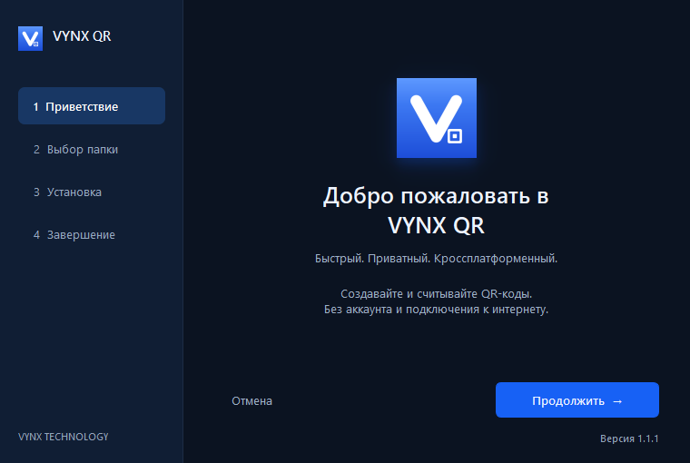
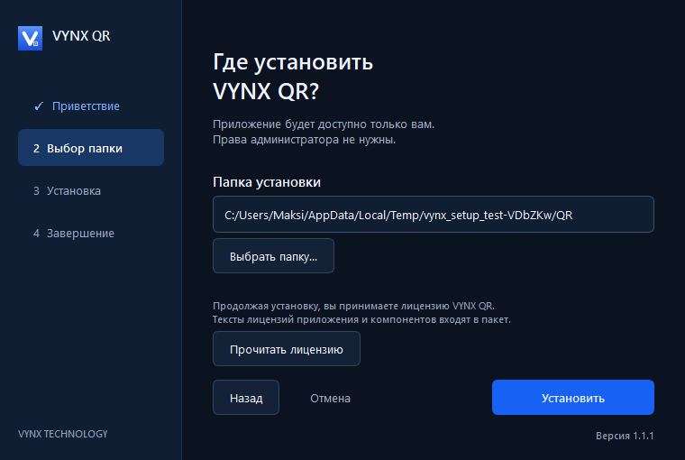

# Branded setup

The supplied reference is implemented as a shared Qt Widgets wizard: navy
sidebar, four steps, product icon, blue action, folder picker, asynchronous
installation, errors with retry, and optional first launch. The native title
bar retains dragging, resizing, keyboard navigation and window-manager support.
The wizard stylesheet uses fixed dark colours on both platforms. It does not
follow system appearance changes; application theme tests do not establish
system-theme support for the installer.

## Packaging

Windows `installer` builds a silent per-user NSIS backend, then wraps it with
a self-extracting bootstrap containing the application's Qt runtime. Normal
launch opens `VYNX QR.exe --setup --backend <extracted backend>` and waits for
the wizard before cleaning its private temporary runtime. `/S` invokes the
backend directly; a final `/D=<absolute path>` remains supported. Existing
install locations are read from HKCU. No elevation or network is required.
The generated uninstall inventory lists exact shipped files; unrelated files
are preserved. Shared integration is removed only by its registered owner.

Linux `appimage` produces both the portable AppImage and a Setup AppImage.
Both contain the same application; the Setup filename selects the wizard.
`--setup` also opens it explicitly. Installation copies the complete AppImage
atomically to `vynx-qr.AppImage` in the chosen directory and registers
`$XDG_DATA_HOME/applications/vynx-qr-local.desktop` (default
`~/.local/share/applications`). It never calls a package manager or requests
root. The desktop entry includes an Uninstall action; the installed image
also accepts `--uninstall`. A per-directory ownership marker protects foreign
directories and allows retry after a partially completed installation.
DEB, Arch and portable Windows packaging keep their existing behavior.

## Validation on 2026-10-25

The checked-in [Windows smoke report](evidence/setup-windows.json) identifies
`VYNX-QR-Setup-x64-1.1.1.exe` and its SHA256. Its results apply to that artifact;
they do not establish acceptance of the 1.1.2 installer. Outstanding Windows
scenarios are tracked in [windows-manual-qa.md](windows-manual-qa.md).

- Windows release application and packaged Setup EXE built with MSVC / Qt 6.8.3.
- CTest `bridge`, `setup`, and `window`: 3/3 passed. Setup tests cover navigation,
  disabled invalid paths, backend failure and returning to folder selection.
- Packaged Windows lifecycle: foreign-directory rejection, silent `/D` with
  spaces and Cyrillic characters, registry and Start Menu paths, installed
  runtime, real application window, normal close, uninstall and preservation of
  an unrelated file. An owned partial extraction can be resumed. Local smoke
  backs up and restores existing registrations
  and shortcuts; it does not upgrade the pre-existing installed application.
- Screenshots above were captured from the actual Qt widgets by the setup test.
- Interactive Computer Use inspection was stopped with Escape and discontinued.
- Linux native build and Setup AppImage lifecycle have **not run locally**:
  WSL reports `HCS_E_HYPERV_NOT_INSTALLED`. CI now includes native Linux backend
  tests and a packaged wizard/install/desktop-launch/uninstall smoke. Those CI
  jobs must pass before claiming Linux artifact validation.

Build Windows with the existing `release` preset and `installer` target.
Build Linux with `linux-appimage` and the `appimage` target. Run `ctest` for
the relevant preset. `scripts/setup-local-smoke.ps1 -Installer <setup.exe>`
tests the Windows artifact in a unique workspace directory and restores
pre-existing per-user integration. The Linux artifact smoke is
`xvfb-run -a python3 scripts/setup-appimage-smoke.py <Setup.AppImage> --report <report.json>`;
it requires the desktop tools installed by the CI workflow and working FUSE.

This initial local checkpoint preceded tagging and remote release validation.
Subsequent validation is recorded in GitHub Actions and the release notes.
